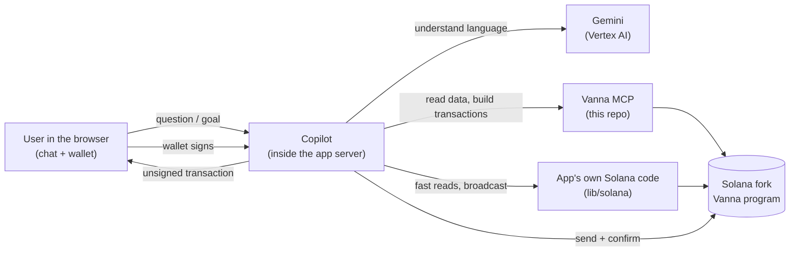
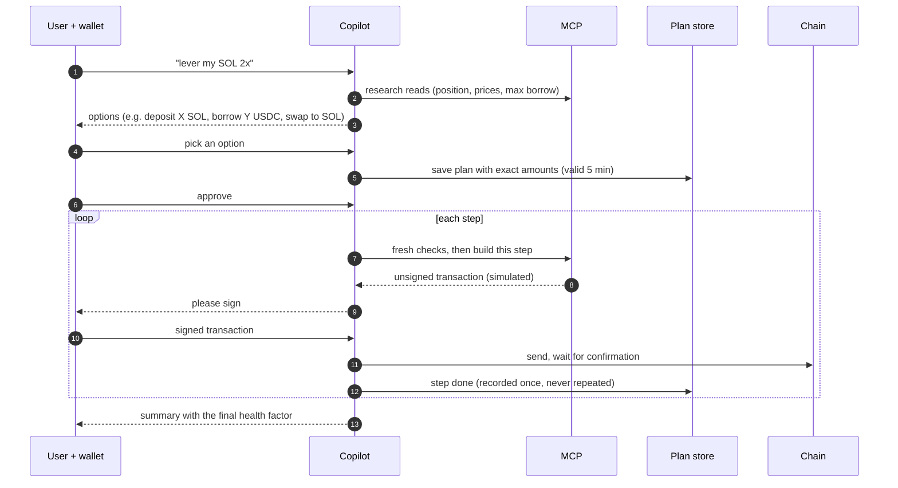

# Vanna Solana Copilot — Architecture

A chat assistant inside the Vanna Solana app. A user types things like *"what's my health factor?"*,
*"supply 100 USDC"* or *"lever my SOL 2x"*; the Copilot answers from live on-chain data and, for actions,
prepares the transactions for the user's own wallet to sign.

Status (2026-09-30): the **MCP server (this repo) is built and verified live** on the Solana fork. The
Copilot itself, which lives in the `vanna-credit-backend` app, is **not started**.

---

## 1. The idea in one picture

Three rules explain almost everything:

1. **The AI only understands language.** Gemini turns a sentence into an intent ("borrow", "USDC", "50").
   Plain code decides amounts, checks risk and refuses unsafe or unsupported requests.
2. **The MCP builds, the wallet signs.** Every transaction is built and simulated by the MCP and handed back
   *unsigned*. Only the user's connected wallet (Phantom, Backpack, Solflare) signs. No server holds a key.
3. **Nothing is "done" until the chain confirms it.** The Copilot never claims success from a built or signed
   transaction, only from a confirmed signature.

## 2. Is it the same as the Stellar Copilot?

**Same design, simpler signing.** It is a port of the Stellar Copilot's structure, not a new invention. Where
Solana differs, it is simpler:

| | Stellar Copilot | Solana Copilot |
|---|---|---|
| Where it runs | Inside the website's server | Same: inside `vanna-credit-backend`'s server |
| AI | Gemini on Vertex AI | Same |
| Tools | Vanna MCP (14 tools) | Same pattern: Vanna Solana MCP (14 tools) |
| Two lanes (quick answers vs. multi-step plans) | Yes | Same |
| Plans stored server-side, approved, run step by step | Yes | Same |
| Who signs | Wallet, **or** a server-side Sign Service with auto-sign | **Wallet only.** No Sign Service, no auto-sign |
| Login | Privy, WorkOS, or a Freighter wallet proof | **Sign-In-With-Solana** (wallet signs a login message) |
| DeFi integrations | Blend, Aquarius, Soroswap | Kamino (lend) and Jupiter (swaps) |
| Prices on the test network | Live oracle | The app's **price keeper** refreshes prices on the fork |

So everything to do with auto-sign, signer binding and the Sign Service is simply **not part of Solana**.

## 3. The pieces

| Piece | Where | What it does |
|---|---|---|
| **Copilot UI** | `vanna-credit-backend/components/copilot`, `/copilot` page | Chat, plan card, approval, step-by-step progress, asks the wallet to sign |
| **Copilot brain** | `vanna-credit-backend/lib/copilot` (server code) | Classifies the request, refuses off-topic or unsafe things, sizes amounts, keeps plans, calls the MCP |
| **Gemini** | Google Vertex AI | Language understanding and answer wording only |
| **Plan and conversation store** | Firestore (a local encrypted file in development) | Keeps each plan and its state, so a step can never run twice |
| **Vanna MCP** | this repo, a separate service | 14 tools: reads (positions, prices, pools, history) and transaction builders (supply, borrow, swap, farm, ...). Never signs or sends |
| **App's Solana code** | `vanna-credit-backend/lib/solana` (already exists) | The same reads the app's pages use, plus the wallet send-and-confirm pipeline |
| **Price keeper** | the app's `POST /api/prices/refresh` (fork only) | Keeps oracle prices fresh on the test fork; the MCP calls it before any risk-checked build |
| **Chain** | hosted Surfpool mainnet fork, program `H37YVBG3…` | Where everything actually happens |

## 4. How a request flows

The Copilot has two lanes. A classifier picks one per message; a refusal (off-topic, liquidation, admin,
unknown token) always wins first.

### 4.1 A question — *"What's my health factor?"* (quick lane)

1. The Copilot knows the wallet from the login cookie.
2. It reads the position from the MCP (`vanna_account` `health`), which knows every asset registered on-chain
   and refuses to answer rather than leave a position out. (The app's `fetchMarginSnapshot` is not used for this
   yet: it only knows the app's five tokens and silently skips any other asset an account holds — see §8.)
3. Gemini words the answer from those numbers only. It never invents a number.

### 4.2 One action — *"Supply 100 USDC"* (quick lane)

1. Classifier: a single, fully specified write.
2. The Copilot calls the MCP tool `vanna_earn_write` `supply`. The MCP builds the transaction, **simulates it on
   the chain**, and returns it unsigned with the simulation result.
3. If the simulation failed, the Copilot shows the reason and stops. Otherwise it shows a summary and asks the
   user to confirm.
4. The wallet signs; the app sends it and waits for confirmation; then the Copilot reports the result.

### 4.3 A goal — *"Lever my SOL 2x"* (plan lane)

Rules the plan lane always follows:

- The browser only sends **ids, the approval, and signed transactions** — never amounts or instructions. The
  server holds the plan.
- An approval is tied to that exact plan and expires after **5 minutes**.
- Before each step it re-reads what may have moved (price, debt, pool liquidity, swap quote); if a step would
  push health below the **1.15** safety floor it pauses.
- Each step can be claimed only once, even with two servers running. An unclear outcome is marked
  **uncertain** and never retried automatically.
- A transaction not confirmed before its blockhash expires is marked **expired** and rebuilt.

## 5. Who does what

| Job | Done by |
|---|---|
| Understand the sentence | Gemini |
| Decide amounts, check risk, refuse | Copilot code (deterministic) |
| Position and health answers | MCP (`vanna_account`, `vanna_margin_status`) |
| Pool numbers, swap quotes, fresh checks between steps | App's `lib/solana` (same as the pages) or the MCP |
| Research reads for plans | MCP read tools |
| Build and simulate every transaction | **MCP** |
| Refresh fork prices before risky builds | MCP calls the app's price keeper |
| Sign | **User's wallet** (also pays the fee) |
| Send and confirm | App server (existing `getConnection`, `confirmSignatureHttp`) |
| Final receipt | `vanna_sign` `tx_status` + the app's history reader |

## 6. What the Copilot may and may not do

- **Assets:** SOL, USDC, USDT can be lent and borrowed. JitoSOL and JupSOL are collateral, swap and Kamino farm
  only. The MCP refuses anything else with `asset_not_offered`.
- **Refused always:** liquidating someone, admin actions, unknown tokens, arbitrary programs, Kamino multi-asset
  liquidity, the test faucet.
- **Liquidation:** read-only — the Copilot can say whether an account is at risk, never execute a liquidation.
- **Health:** the protocol liquidates at 1.10; the Copilot sizes to stay at or above 1.15 (same as the app's
  "max" buttons).
- **The model never sees** transactions or signatures, only summaries.

## 7. How the Copilot talks to the MCP

- **Transport:** Streamable HTTP. `POST /mcp` with `initialize` → keep the `mcp-session-id` → `tools/call`.
  If the server answers **404** the session was lost (another instance); re-initialize and retry.
- **Tools (14):** `vanna_protocol_info`, `vanna_oracle`, `vanna_earn_market`, `vanna_earn_position`,
  `vanna_earn_write`, `vanna_account`, `vanna_margin_status`, `vanna_margin_trade`, `vanna_wallet`,
  `vanna_history`, `vanna_farm_overview`, `vanna_farm_kamino`, `vanna_swap`, `vanna_sign` (`tx_status` only).
  Full list of actions: `TOOLS_CATALOGUE.md` §3.
- **Write result (envelope):** `transactions[0].unsignedTransaction` (base64, v0), `requiredSigners`, `blockhash`,
  `lastValidBlockHeight`, `simulation_success`, `code`/`reason` when rejected, `summary`. **One transaction per
  action today.** Amounts are decimal strings.
- **Errors:** always `{"error": "<code>", "message": "..."}` — e.g. `invalid_input`, `asset_not_offered`,
  `price_unavailable`, `insufficient_scope`, `rate_limited` (HTTP 429 with `Retry-After`).
- **Auth (hosted):** a machine token for the Copilot app; listing its client id in `FIRST_PARTY_CLIENT_IDS` gives
  it write access. Locally the MCP can run without auth.

## 8. Verification — will this work?

Checked on 2026-09-30 against the real code of both repos and the live fork.

**Works today (verified):**

| Claim | Evidence |
|---|---|
| MCP reads and builds work on the current program | 211 live tests pass on the fork |
| The MCP works as a deployed service, as a client would call it | Docker image built and run; end-to-end HTTP test (initialize, session id, tools, errors, 404, 429) passes against it |
| App's `lib/solana` matches the current program | Backend commit `813fad3` moved it to the new oracle model (IDL with `OracleConfig`, oracle accounts in health checks); its own end-to-end script (`scripts/e2e-fork.ts`: Earn supply/redeem, margin create/deposit/borrow/repay/withdraw, history) passes on the fork, run 2026-09-30 |
| App's send-and-confirm and wallet pieces exist | `getActiveSigner`/`TxSigner`, `getConnection`, `confirmSignatureHttp`, `healStaleDexPools` in `lib/solana` |
| The checks a plan needs before each step exist in the app | `fetchMarginSnapshot`, `fetchPoolStates`, `fetchJupiterQuote`, `readReserveRate`, `maxBorrowUsd`, `projectHealthFactor` |
| Error text from the MCP fits the ported client | errors are short JSON the client can parse |

**Gaps to handle while building (none blocks starting):**

| Gap | Handling |
|---|---|
| The MCP's `preview` (before/after health factor) is not filled | The approval card gets the numbers from `vanna_margin_status` `can_borrow` / `can_withdraw` (or the MCP fills `preview` later) |
| The app's token list has only 5 assets; the chain also has JupUSD, NVDAx, TSLAx | The app's `fetchMarginSnapshot` silently skips a position in one of those (health shown without it; writes still fail safely). So the Copilot takes positions from the MCP. The app's Margin page has the same blind spot; scope decision pending |
| All Copilot users share one MCP rate-limit bucket | The Copilot limits per user and backs off on 429; raising or per-user limits pending |
| Very large transactions (long swap routes) | The MCP returns `transaction_too_large`; the Copilot retries with a smaller amount. Lookup-table setup rounds are not built (not needed so far) |
| The fork's clock drifts and prices can go stale | The MCP refreshes (keeper + its own guarded supplement); a still-stale price makes the build fail safely |

**Needs a decision before a hosted launch** (open questions): Google Cloud project, Gemini model and Firestore
for the Copilot; which service issues the Copilot's token for the MCP; where the MCP is hosted.

**Verdict:** the architecture works with what exists. The only new code is the Copilot itself in the app.

## 9. Build order

1. **Read-only Copilot:** MCP client, wallet login (Sign-In-With-Solana), quick-lane answers, `/copilot` page.
2. **Single actions:** approval card, the wallet signs, the app sends and confirms. The first real signed round
   trip is the last open check before the Copilot is "ready".
3. **Plans:** plan store, research, step-by-step execution with fresh checks.
4. **Kamino and Jupiter strategies**, page assistant, then hosted deployment.

## 10. Decisions in force

| Topic | Decision |
|---|---|
| Network | Hosted Surfpool mainnet fork `https://rpc-devnet.solana.vanna.finance`, program `H37YVBG3eGtz89ofd7iDLc2PJgn12778392XeU2QJcGC` (vanna-credit-layer `ecdb9b6`) |
| Who builds transactions | The MCP (unsigned, simulated) |
| Who signs | The user's wallet; no Sign Service, no auto-sign |
| Prices on the fork | The app's price keeper (Jupiter prices); no Hermes this release |
| Lend/borrow | SOL, USDC, USDT only |
| Liquidation, admin, faucet | Not offered by the Copilot |
| Swaps and Kamino | Supported (Jupiter swaps; Kamino single-asset supply from the margin balance) |
