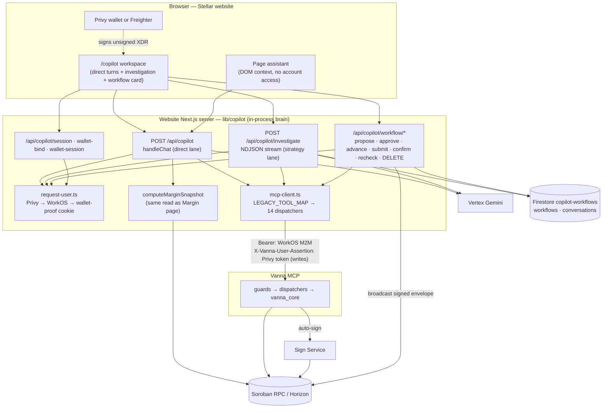
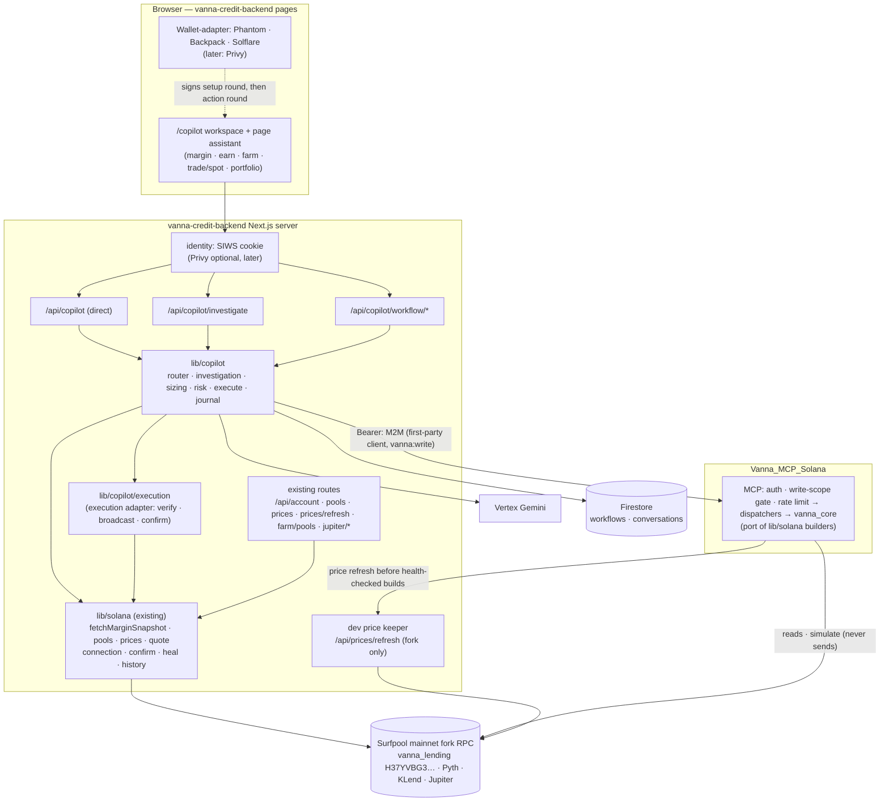
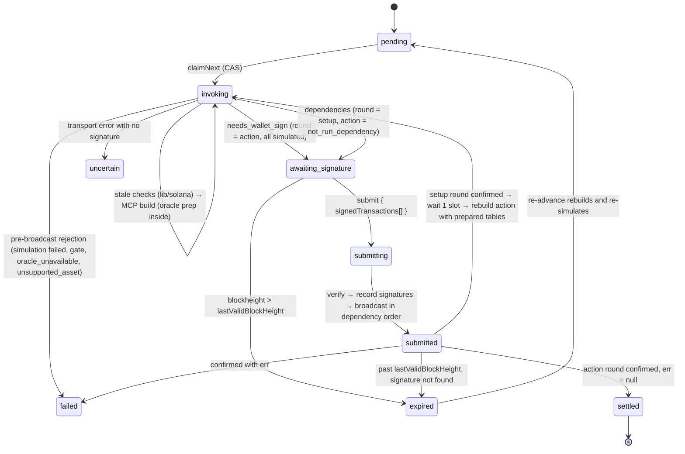

# Vanna Copilot — Stellar (verified) and Solana (integration architecture)

Part A is the Stellar Copilot as it actually runs, verified against the code.
Part B is the architecture for integrating the Solana Copilot into the Solana
app `vanna-credit-backend`, with this repo (`Vanna_MCP_Solana`) as its MCP
backend. The MCP side of Part B is built (`BUILD_PLAN.md`); the Copilot side in
`vanna-credit-backend` is not started. Settled and open decisions: `DECISIONS.md`.

**Sources for Part A**

- `mercury-stellar-backend`, branch `copilot-upgrade` (the Stellar website with the Copilot):
  `app/api/copilot/**`, `lib/copilot/**` (135 files), `hooks/use-investigation.ts`,
  `hooks/use-workflow.ts`, `components/copilot/**`, `docs/copilot/*`.
- `Vanna_MCP/vanna-mcp` (MCP server and `sign-service/`).

**Sources for Part B**

- `vanna-credit-backend` @ `27e6129` (merge of `solana-app`), re-checked at `f643dbf` (Kamino update, GCP setup): the Solana app, and the
  target of this integration. Next.js 16 / React 19, `@solana/wallet-adapter`
  (Phantom, Backpack, Solflare), Anchor 0.32, zustand, react-query. Its service layer
  `lib/solana/*` builds every transaction. It runs against program `H37YVBG3…` on
  the hosted Surfpool mainnet fork.
- `vanna-credit-layer`: the `vanna_lending` program source, the authority for on-chain rules.
- `Vanna-Solana-Copilot-Answers.pdf` (28 Sep 2026, in this repo): the team's answers to the
  build questions, plus the team's 2026-09-29 follow-up decisions (`DECISIONS.md`). Both are
  applied throughout Part B.
- `TOOLS_CATALOGUE.md` in this repo (the frozen v1 MCP tool surface and envelope schema).
- `Backend-Solana` is **not** used as a reference; it belongs to the old stack.

The backend is under active development, so Part B treats `lib/solana` as an evolving
reference and connects to it through narrow interfaces: reads, oracle preparation, execution.

---

# Part A — Stellar, verified

## A.0 Corrections to the earlier (inferred) version of this document

| Earlier assumption | What the code shows |
|---|---|
| A separate backend-for-frontend runs a generic LLM tool loop | The Copilot brain is **in-process TypeScript inside the website's Next.js server** (`lib/copilot`). There is no generic "model picks tools" loop on the write path. |
| The LLM decides what to do | The LLM **only interprets language**. Deterministic code owns amounts, assets, ordering and refusals. The MCP and the Sign Service own risk and spend policy. |
| One chat endpoint | **Two lanes**. The *direct* lane is `POST /api/copilot`. The *strategy* lane is `POST /api/copilot/investigate`, which feeds a server-held workflow API under `/api/copilot/workflow/*`. |
| Plans live in the chat response | Strategy plans are **server-held workflow records** in Firestore (encrypted, compare-and-swap). The browser sends only ids, a revision/digest and signed envelopes, never steps or amounts. |
| Every read goes through the MCP | Position questions use `computeMarginSnapshot`, the same read the Margin page uses. The investigation fast path answers simple reads without the model loop. |
| The LLM provider is unspecified | Vertex Gemini: `gemini-3.7-flash`, with `gemini-3.5-flash-lite` for social replies and a fallback chain of 2.5 / 2.0 Flash. |
| Privy is the only identity | Three anchors: Privy (default), WorkOS (optional), and a **Freighter wallet proof** (a SEP-53 signed challenge sealed in a cookie). |

## A.1 Components

| Component | Where | Role |
|---|---|---|
| Copilot UI | `components/copilot/*`, `hooks/use-investigation.ts`, `hooks/use-workflow.ts` | `/copilot` workspace, page assistant (`assistant-launcher.tsx`, driven by DOM context and `data-copilot-id`), plan card, execution stepper, browser-side signing (`sign-xdr.ts`), wallet-bind on connect |
| Copilot brain | `lib/copilot/*` in the website's Next.js server (Node runtime) | Entry lane classification, domain firewall, router, plan IR, investigation loop, workflow journal, MCP client, identity |
| LLM | Vertex AI (Gemini Flash family) | Classifier, goal extraction, investigation decisions, answer formatting, receipt |
| Workflow + session store | Firestore database `copilot-workflows` (project `vanna-mcp`) | Workflow records and conversations, AES-256-GCM encrypted, compare-and-swap; encrypted local journal in development only |
| Vanna MCP | `Vanna_MCP/vanna-mcp` (FastMCP, Streamable HTTP) | 14 dispatcher tools; builds unsigned XDR; calls the Sign Service for auto-sign |
| Sign Service | `vanna-mcp/sign-service` | Privy signing, sessions, policy engine and caps, identity bindings, connect |
| Chain | Soroban RPC and Horizon | The browser or the server broadcasts; Horizon/RPC is used for settlement |

## A.2 Topology



## A.3 Identity

`request-user.ts` resolves the caller once per request, in this priority order:

| Anchor | Proof | `sub` | Can auto-sign |
|---|---|---|---|
| Privy (default) | `x-privy-token` verified against Privy JWKS | `did:privy:…` | Yes, once the Vanna signer is bound |
| WorkOS (optional) | Connect OAuth session cookie, refreshed at the route edge | WorkOS user | Through its linked Privy DID |
| Freighter / extension wallet | `/api/copilot/wallet-session`: challenge, then a SEP-53 signature, then a sealed cookie | `stellar:<G…>` | **No**. Reads and wallet-signed writes only. The cookie is never forwarded. |

Each MCP call carries two credentials:

- `Authorization: Bearer` is the WorkOS M2M token. It answers **which application** is calling.
- `X-Vanna-User-Assertion` is the end user's token. It answers **which user**. The MCP forwards it and the Sign Service verifies it.

The code keeps three permissions distinct:

1. **Wallet connected.**
2. **Vanna signer bound.** Privy `addSigners` plus a Sign Service registration via `/api/copilot/wallet-bind`, run on connect and never as a side effect of auto-sign.
3. **Auto-sign session armed.** A capped, revocable Sign Service session, toggled separately.

## A.4 Entry: which lane owns a prompt

`entry-lane.ts` classifies each prompt as `direct` or `strategy`:

- **direct**: the router fully resolves it, meaning a read, a client action, or a single write with every slot filled.
- **strategy**: open-ended goals, unsized writes, comparisons, swaps, and account creation.
- A settled router refusal (such as "send my funds to G…" or "settle my account") outranks both lanes, so refusals stay deterministic.
- On this branch an `INVESTIGATE_FIRST` experiment sends nearly every prompt through investigation first, because concrete instructions that skipped research produced the defects listed in `FIX-LIST-copilot-upgrade.md`. Reads stay cheap because the investigation fast path answers them without the loop (health in about 16 ms, price in about 0.55 s).

## A.5 Direct lane — `POST /api/copilot` (`handleChat`)

The request runs through these stages in order:

1. **Structured client actions.** `summarize_execution`, or an `approved_plan` replayed verbatim.
2. **Domain firewall.**
3. **Auto-sign control.**
4. **Resume.** `pending_write`, or `resume_multi_leg`.
5. **Page-assistant gate.**
6. **Routing.** The keyword router runs first. Vertex is used only if needed, followed by deterministic corrections.
7. **Plan extraction.** Step extraction, sanitising, then residue handling.
8. **Conditional guard.**
9. **Execution.** One of: a read, a single write, or a multi-leg plan.

Multi-leg plans in this lane:

- **Plan identity.** `freezePlan` produces `plan_id = sha256(all executable slots)`. `verifyApprovedPlan` rejects the plan if the id changed or it is older than 5 minutes.
- **Execution order.** Legs run in sequence. Between legs the lane waits for the Horizon sequence, and it pauses if health would fall below the floor.
- **Write outcomes.** A write ends as `executed`, `needs_wallet_sign`, `needs_wallet_bind`, or falls back to the local executor. A 15-second dedupe lock prevents double submission.

## A.6 Strategy lane — investigate, propose, approve, execute

```mermaid
sequenceDiagram
  autonumber
  participant B as Browser (use-investigation / use-workflow)
  participant I as /api/copilot/investigate
  participant W as /api/copilot/workflow/*
  participant J as Workflow journal (Firestore)
  participant V as Vertex Flash
  participant M as Vanna MCP
  participant S as Sign Service
  participant C as Chain

  B->>I: { message, wallet, continuation?, answers?, history ≤ 8 }
  I->>V: classify → goal → decision loop (≤ 24 reads, ≤ 12 turns, 45 s)
  I->>M: read tools (8 per turn, 15 s each), evidence ledger
  I-->>B: NDJSON progress events … result (candidates + sealed continuation)
  B->>W: propose { continuation, candidateId }
  W->>M: re-resolve scope, size steps (WAD), validate
  W->>J: create (digest = sha256(proposal), TTL 5 min)
  W-->>B: WorkflowView (sized steps, funding preview)
  B->>W: approve { revision, digest }
  W->>J: proposed → validating → approved (fresh risk/balance read)
  loop each step
    B->>W: advance
    W->>M: re-resolve scope; stale checks (swap floor, position, liquidity, payout)
    W->>J: claimNext (CAS; one claim per leg across replicas)
    W->>M: write tool (args from re-resolved scope, not browser)
    alt MCP auto-signed (tx_hash)
      M->>S: sign + submit
      S->>C: broadcast
      W->>J: submitted → settle (ledger lookup) → settled
    else signing_status = needs_wallet_sign
      W->>J: awaiting_signature (unsigned XDR stored)
      W-->>B: unsigned XDR (+ Sign Service refusal reason verbatim)
      B->>B: wallet signs
      B->>W: submit { signedXdr }
      W->>M: re-validate risk for this step
      W->>C: server broadcasts, then settles
    else pre-broadcast rejection (code / reason / simulation_success=false)
      W->>J: failed, with the MCP's one-line reason
    else anything ambiguous
      W->>J: uncertain (never auto-retried)
    end
  end
```

**Journal states** (`lib/copilot/workflow/types.ts`):

- Workflow: `proposed → validating → approved → running ⇄ awaiting_signature → completed | blocked | cancelled | uncertain`. A retryable validation failure (for example a flaky RPC) returns to `proposed`. A policy refusal becomes `blocked`.
- Step: `pending → invoking → (awaiting_signature → submitting) → submitted → settled | failed | uncertain`. At most 8 steps.
- Step sizing basis: `stated`, `derived_max_at_floor`, `whole_position`, or `settled_payout`. For a derived amount, leg 2 may send leg 1's measured payout, but only inside the band the user approved, and only downward.

## A.7 Invariants worth copying (all enforced in code)

1. **The browser never sends execution instructions.**
   - `investigate` accepts only a question, a wallet, and a continuation.
   - `propose` accepts only a continuation and a candidate id.
   - `submit` accepts only `signedXdr`.
   - Any extra key is rejected with a 400.
2. **Identity arguments come from re-resolved scope**, never from the request. Every workflow call re-resolves `{subject, trader, smartAccount, network}` and rejects the call if it has changed.
3. **Approval is bound** to the proposal `revision` and `digest`, the subject, the wallet, the network and the MCP server URL. It lasts 5 minutes, and a crash during validation never counts as an approval.
4. **Exactly-once legs.** Firestore preconditions (compare-and-swap) mean neither a repeated POST nor another replica can claim a leg twice.
5. **Ambiguity is terminal.** A write with no transaction hash and no proven pre-broadcast rejection becomes `uncertain` and is never retried automatically.
6. **The MCP's `signing_status` outranks `error`.** An unsigned-but-signable envelope goes to wallet signing and is not reported as a failure. The Sign Service's refusal text is passed through verbatim.
7. **Stale-state re-reads before spending an approval.** The executor re-quotes the swap floor, re-reads the position amount, re-reads liquidity amounts, and records a balance baseline before removals.
8. **Guardrails at the route edge.** Every route checks the origin, caps the body size (96 to 110 KB), and applies a 75 s deadline inside `maxDuration` 120. Research is also gated on network (`testnet` only) and on the secret's length.

## A.8 MCP usage and deployment

- **MCP client.** `mcp-client.ts` speaks Streamable HTTP (POST, SSE `message` frames, and `mcp-session-id`). `LEGACY_TOOL_MAP` / `toServerCall` translate internal names into the 14 dispatchers: `oracle, protocol_info, account, margin_status, margin_trade, earn_market, earn_position, earn_write, farm_overview, farm_blend, farm_lp, swap, wallet, sign`.
- **Deployment.** Cloud Run (`deploy-copilot.yml`, `cloudbuild.yaml`), Vertex in the app project, and Firestore in `vanna-mcp`.
- **Open item.** The runtime service account `vanna-app-run@vanna-main` still lacks the `roles/datastore.user` grant on that database (`WORKFLOW_STORE.md`).

---

# Part B — Solana Copilot + MCP integration (into `vanna-credit-backend`)

## B.0 The shape: same as mercury, so the Copilot is ported in-process

`vanna-credit-backend` is a Next.js app with its own server routes (`app/api/*`), the same shape as mercury. So the Solana Copilot lives **inside this app**, exactly as the Stellar Copilot lives inside mercury:

- the brain in `lib/copilot`;
- routes under `app/api/copilot`;
- UI in `components/copilot`.

It is a module-for-module port, not a separate service. Only the chain-facing parts change, and most of those already exist in `lib/solana`.

| Repo | Role |
|---|---|
| **`vanna-credit-backend`** | The Solana app **and** the Copilot host: pages, `lib/solana` service layer, the new `lib/copilot`, Copilot routes and UI |
| `Vanna_MCP_Solana` (this repo) | MCP server (tools in `TOOLS_CATALOGUE.md`). No Sign Service: the user's connected wallet signs (`DECISIONS.md` D3) |
| `vanna-credit-layer` | Program source, and `bootstrap-fork.sh` for protocol setup on the fork |

New folders in `vanna-credit-backend`. Everything else in the app stays as it is.

```
vanna-credit-backend/
├── app/
│   ├── copilot/page.tsx                  /copilot workspace
│   └── api/copilot/
│       ├── route.ts                      direct lane (GET health, POST chat)
│       ├── investigate/route.ts          strategy research (NDJSON)
│       ├── workflow/propose/route.ts
│       ├── workflow/[id]/{route,approve,advance,submit,confirm,recheck}/route.ts
│       ├── session/[[...id]]/route.ts    conversations
│       └── wallet-session/route.ts       Sign-In-With-Solana proof
├── lib/copilot/                          ported mercury brain (B.10)
├── components/copilot/                   workspace, page assistant, plan card, stepper, sign-bundle
└── hooks/use-investigation.ts, use-workflow.ts
```

## B.1 What the app already provides

Most of what mercury had to build around Stellar already exists in `lib/solana`, and the Copilot calls it directly:

| Copilot need | Existing in `vanna-credit-backend` | Notes |
|---|---|---|
| Position answers (mercury's `computeMarginSnapshot`) | `fetchMarginSnapshot` in `lib/solana/margin.ts` | Already behind the Margin page and `/api/account/[addr]`, so chat and page can never disagree. Exact HF, `stalePrices`, accrued debt, cToken valuation. |
| Pool, lender, wallet, price reads | `fetchPoolStates`, `fetchLenderPositions`, `fetchWalletBalances`, `readOnchainPrices` | Fast path and stale checks |
| Risk formulas | `maxBorrowUsd`, `maxWithdrawUsd`, `maxLeverageFor`, `projectHealthFactor`, `SAFE_HEALTH_FACTOR = 1.15` | The Copilot's sizing floor reuses these, so "max" in chat equals "max" on the page |
| Swap and farm data | `fetchJupiterQuote`, `/api/farm/pools` (Kamino live APYs), `readReserveRate` / `underlyingForReceipts` | Swap-floor and payout re-checks |
| Price freshness (dev) | `refreshForkPrices` + `healKaminoReserves` (the server side of `POST /api/prices/refresh`) | The fork's **development** oracle mechanism. The MCP's `dev-fork` oracle adapter calls it; it is never presented as production oracle publication. |
| Broadcast and confirm | `getConnection()`, `confirmSignatureHttp`, `healStaleDexPools` | Building blocks for the Copilot's **execution adapter** (B.7). `sendInstructions` itself is not reused: it builds, asks for signatures, broadcasts and confirms in one call. |
| Signing model | `TxSigner` (`wallet-bridge.ts`): *"services only ever sign; broadcasting always goes through the app's own fork connection"* | Already the Copilot's rule: the wallet signs, the server broadcasts |
| Errors | `decodeProgramError` (56 program errors), `lib/errors/normalize.ts` | One-line receipts |
| Receipts | `fetchMarginHistory` / `fetchEarnHistory` (event-decoded, with post-action HF) | Settlement read-back |
| Token vocabulary | `tokens.ts` registry, `findToken` (accepts `wSOL`), `KAMINO_RECEIPTS` | Router slots and firewall asset list |
| Test harness | `scripts/e2e-fork.ts`, `scripts/e2e-exec.ts` with `keypairSigner` | Drive Copilot workflows end to end on the fork |

## B.2 Solana and fork facts, and where they land

| Fact | Consequence | Lands in |
|---|---|---|
| One margin account per wallet, `marginPda(owner)` | Scope is `{subject, trader = wallet, smartAccount = marginPda(wallet), network}` with no registry lookup | `investigation/scope.ts` |
| The target cluster is the **hosted Surfpool mainnet fork** `https://rpc-devnet.solana.vanna.finance` (`DECISIONS.md` D1) | Blockhash, reads and broadcast all use the one configured RPC. A user's wallet may be set to another cluster, which is harmless because the app broadcasts. The research gate is `COPILOT_RESEARCH_NETWORK` = the configured cluster label (`surfpool-fork`) instead of `testnet`. Explorer links use custom-cluster mode. | `config.ts`, broadcast |
| Prices expire after `max_price_age_secs` on the **chain clock**; the fork has no Pyth pusher | Before every health-checked build the MCP calls the app's price keeper (`POST /api/prices/refresh`, Jupiter USD prices written to the fork's oracle accounts; `DECISIONS.md` D4). No Hermes/`pyth-pull` in this release. A still-stale price makes the simulation fail closed (`stale_price`), which stops the leg (`step_not_ready`, retryable). | MCP builders, `execute.ts` |
| Every transaction is v0; big ones need **lookup-table setup** that must be confirmed before the action can be simulated | The MCP returns the setup transactions plus the action as `not_run_dependency`. The step runs in two signing rounds: setup, then the rebuilt and re-simulated action (B.7). A dependent action is never reported as simulated. | journal step, advance, submit |
| A signature is known before broadcast | Record signatures first. Once past `lastValidBlockHeight` with no signature found, the step is `expired` and gets rebuilt, not left `uncertain` | journal, settle |
| Cloned DEX pools drift | On a failed simulation at submit, `healStaleDexPools` and re-simulate the **same signed** transaction (healing changes chain state, not the transaction) | submit |
| After a leg lands at slot N | The next leg's reads use `minContextSlot ≥ N` | `execute.ts` |
| HF rule: liquidatable when debt > 0 and HF ≤ 1.10 (equality liquidatable); zero debt = "no debt"; the app's 1.15 is **UI policy** | The Copilot `MIN_HEALTH_FACTOR` policy floor is 1.15 (`SAFE_HEALTH_FACTOR`) instead of mercury's 1.3, so Copilot sizing matches the UI's max buttons. The protocol threshold comes from the pinned program version, never from this constant. | `config.ts`, `workflow/risk.ts`, sizing |
| Assets (`DECISIONS.md` D2): SOL, USDC, USDT lend + borrow; JitoSOL, JupSOL collateral, swap and Kamino farm only; kTokens discovered from on-chain `AssetConfig`; no Perps page; Kamino single-asset only | Router and firewall vocabulary from the display catalogue. A lend or borrow of JitoSOL/JupSOL is refused (`asset_not_offered`). Refuse Kamino Liquidity, unknown mints and arbitrary program calls deterministically. A position in an unsupported asset stops the workflow (`unsupported_asset`) rather than being ignored. | `router.ts`, `domain-classifier.ts` |
| Liquidation, admin, faucet | Not offered by the Copilot in v1: liquidation execution is keeper-only and off, admin has no wrappers, the faucet is a fork-only dev tool that the Copilot never calls. Liquidation **risk** reads (`check_liquidatable`) are offered. | router refusals |

## B.3 Topology



## B.4 Identity

The app has **wallet-adapter only, with no Privy**. Every write is signed by the connected wallet, which is also the fee payer (`DECISIONS.md` D3), so there is no auto-sign and no signer binding:

| Anchor | Proof | `sub` | What works |
|---|---|---|---|
| Wallet (Phantom, Backpack, Solflare) | `/api/copilot/wallet-session`: challenge, then `signMessage`, then ed25519 verify, then a sealed HttpOnly cookie (mercury's Freighter path with SIWS instead of SEP-53) | `solana:<base58>` | Everything. Every write is wallet-signed. |
| Privy (optional, later) | `x-privy-token`, verified against Privy JWKS | `did:privy:…` | An alternative login only; it adds no signing capability |

MCP credentials:

- The app's M2M bearer is sent on every call. Its client ID is listed in the MCP's `FIRST_PARTY_CLIENT_IDS`, which grants write scope; without it the MCP hides the write-only tools and refuses write actions (`insufficient_scope`).
- The SIWS cookie is never forwarded. Every write envelope comes back `needs_wallet_sign`.
- `X-Vanna-User-Assertion` is optional; the MCP carries it only for per-user features and never treats it as authorization.
- Which login provider issues the M2M token is still open (`DECISIONS.md` O2).

The page is same-origin with its API (one Next.js app), so there are no cross-origin cookie or CORS concerns. Mercury's single `publicOrigin` check applies as is.

## B.5 Lanes

These are the same as Stellar: the entry classifier, the settled-refusal rule, and optionally `INVESTIGATE_FIRST`.

**direct** (`POST /api/copilot`):
- Position and health answers come from `fetchMarginSnapshot`.
- Pools and APYs come from `fetchPoolStates`; Earn balances from `fetchLenderPositions`; prices from `readOnchainPrices`.
- A single sized write goes to the MCP write envelope.

**strategy** (`investigate`, then `workflow/*`):
- Used for goals like "best yield on my USDC", "lever SOL 3×", "move my USDT into a Kamino farm", swaps, and account creation.
- The investigation fast path uses the same `lib/solana` reads. The Flash loop's read allowlist is the MCP read dispatchers (B.8).

**Page assistant:** mounted on `/margin`, `/earn`, `/earn/[id]`, `/farm`, `/farm/[id]`, `/trade/spot` and `/portfolio`. It gets DOM context and `data-copilot-id` tags, and has no account access.

## B.6 Who does what

| Job | Done by | Why |
|---|---|---|
| Answer position, pool and price questions | `lib/solana` in-process | Fast, and identical to what the pages show |
| Research reads in the Flash loop | MCP read tools | Same tool surface as third-party agents, sanitised, rate-limited |
| Build every write transaction | **MCP** (`vanna_core`): unsigned v0 builders from the pinned IDL, whose instruction construction is parity-tested against `lib/solana` | Decided (answers PDF): one builder for Copilot and external agents; the MCP never signs, sends or confirms |
| Prepare oracle inputs | MCP calls the app's price keeper (`POST /api/prices/refresh`) before every health-checked build (`DECISIONS.md` D4) | Refreshes every asset's price, not just the requested one |
| Stale checks before spending an approval | `lib/solana` reads | See B.7 |
| Sign | The user's connected wallet (`signTransaction` on the v0 transaction); it is also the fee payer (`DECISIONS.md` D3) | Keys never touch the app or the MCP; no private keys in any envelope |
| Verify, broadcast and confirm | **Execution adapter** `lib/copilot/execution/` on `getConnection()` + `confirmSignatureHttp` + `healStaleDexPools`. Returns `{requestId, status, signatures, error}` with status `awaiting_approval` / `submitted` / `confirmed` / `failed` | The adapter lives in the app, reusing the existing wallet send pipeline |
| Receipt and settlement read-back | `fetchMarginHistory` event for the signature, plus a fresh snapshot at `minContextSlot` | Post-action HF straight from the program's event |

**Parity guard.** The MCP's builders are a Python port. Mercury's sources-of-truth check (tolerance of the larger of $0.50 or 0.5%) compares the MCP's `preview` with a `lib/solana` projection before approval. The MCP's tests replay the backend's `e2e-fork.ts` and `e2e-exec.ts` flows and require identical instructions.

## B.7 Workflow execution on Solana

The journal, the compare-and-swap claims, the approval binding, the 5-minute TTL and the A.7 invariants all port unchanged. The step record gains:

```ts
type SolanaStepState = {
  status: "pending" | "invoking" | "awaiting_signature" | "submitting"
        | "submitted" | "settled" | "failed" | "uncertain" | "expired";   // + expired
  round: "setup" | "action";       // setup only when the MCP returned dependencies
  transactions?: Array<{           // mirrors envelope v1 (TOOLS_CATALOGUE §2.1)
    id: string;
    purpose: string;               // "create_lookup_table" | "extend_lookup_table" | "oracle_update" | "deposit_and_borrow" | "margin_execute:kamino" …
    dependsOn: string[];
    unsignedTransaction?: string;  // base64, never shown to the model
    simulationStatus: "success" | "failed" | "not_run_dependency";
    signature?: string;            // recorded BEFORE broadcast
    lastValidBlockHeight: string;
    landedSlot?: string;
  }>;
  prepared?: { addressLookupTables: string[] };   // passed back to the MCP to rebuild the action
  minContextSlot?: string;
  requestId?: string;              // execution adapter id
};
```



**`advance`** (per leg):

1. Re-resolve scope.
2. Run the stale checks below.
3. Claim the step.
4. Call the MCP write tool with arguments taken from scope (plus `prepared` on the action round). The MCP prepares oracle inputs itself (catalogue §2.3).
5. Branch on the envelope:
   - every transaction `success` → `awaiting_signature` (action round);
   - any `not_run_dependency` → store only the setup transactions, `awaiting_signature` (setup round);
   - `code` / `reason` / `simulation_success = false` → `failed` with the one-line reason.

**`submit`** accepts only `{ signedTransactions: string[] }`. The execution adapter:

1. Checks that each message equals the stored unsigned message apart from signatures, that the fee payer and required signers are the scope wallet, and (setup round) that only lookup-table create/extend with the wallet as authority is present.
2. Re-validates risk for the step.
3. Records the signatures.
4. Broadcasts in `dependsOn` order and confirms each. On the fork, a failed pre-send simulation may run `healStaleDexPools` and simulate the **same signed** transaction once more.
5. After a **setup** round: waits one slot, then the step goes back to `invoking` and the action is rebuilt and re-simulated with the prepared tables. The wallet signs a second time; the Copilot never signs an action whose simulation hasn't run.
6. After an **action** round: settles.

**Settle:** `getSignatureStatuses` plus block height. Record `landedSlot`, which becomes the next leg's `minContextSlot`. Attach the `fetchMarginHistory` row (event, post-action HF) to the receipt. For repay-all legs, re-read the remaining debt; if it isn't zero, the close-debt leg is re-sized or skipped rather than assumed.

**Composite atomicity.** When `vanna_deposit_and_borrow` (or any composite) reports `atomic: false`, the plan card shows it as separate transactions and the approval text says so.

Stale checks mapped to the app's functions:

| Mercury check | Solana check (in-process) |
|---|---|
| `staleSwapFloor` | `fetchJupiterQuote` re-quote vs the approved `min_received`; refuse, or lower within the approved band |
| `stalePositionAmount` | `fetchMarginSnapshot`: re-read debt (accrues) and vault balances for whole-position legs |
| `staleLiquidityAmounts` | `fetchPoolStates`: the borrow must still fit `projected.accountedLiquidityAssets`; redeem must fit available cash |
| `settledRemovalPayout` / baseline | Kamino redeem: `readReserveRate` → `underlyingForReceipts`; Earn redeem: the share → asset preview; the vault/wallet balance before and after |
| Health-floor pause | `projectHealthFactor` on the projected USD vs the `MIN_HEALTH_FACTOR` policy floor (1.15). Stale prices are not a pause condition here because the MCP refreshes them through the keeper; a `stale_price` build result is. |

## B.8 MCP contract (dispatchers over `TOOLS_CATALOGUE.md`)

| Dispatcher | Scope | Actions (catalogue tools) |
|---|---|---|
| `vanna_oracle` | read | `price`, `prices` (on-chain oracle facade, chain-clock age, `stale`, `source`) |
| `vanna_protocol_info` | read | `config`, `assets`, `integrations` |
| `vanna_account` | read + write | `resolve`, `get`, `health`, `create`, `close` |
| `vanna_margin_status` | read | `collateral`, `debt`, `can_borrow`, `can_withdraw`, `max_borrow`, `max_withdraw`, `liquidation_snapshot` (eligibility read only; no liquidation execution in the Copilot) |
| `vanna_margin_trade` | write | `deposit`, `withdraw`, `close_collateral`, `open_debt`, `borrow`, `close_debt`, `repay`, `repay_from_wallet`, `deposit_and_borrow`, `close_position` |
| `vanna_earn_market` / `vanna_earn_position` | read | `pool_stats` / `deposited_balance`, `earned_interest` |
| `vanna_earn_write` | write | `supply`, `redeem` |
| `vanna_farm_overview` | read | `markets` (with Kamino live APYs), `positions` |
| `vanna_farm_kamino` | write | `deposit` (from the margin balance, no leverage — `DECISIONS.md` D6), `redeem` |
| `vanna_swap` | read + write | `quote`, `can_swap`, `margin_swap`, `wallet_swap` |
| `vanna_history` | read | `margin`, `earn` |
| `vanna_wallet` | read | `summary`, `balance`, `token_metadata` |
| `vanna_sign` | read | `tx_status` only — signing is the wallet's (`DECISIONS.md` D3) |
| `vanna_fork` | dev | `faucet`; registered only on a fork with `ENABLE_FORK_TOOLS=true`; never in the Copilot's allowlist |

Not exposed: liquidation execution (keeper builder, off by default) and every admin instruction.

**Write envelope** (catalogue §2.1, schema v1):

- `schemaVersion`, `cluster`, `programId`, `feePayer`, `transactions[]` (`id`, `dependsOn`, `unsignedTransaction`, `blockhash`, `lastValidBlockHeight`, `requiredSigners`, `simulation.status`), `summary`, `preview`, plus the Stellar-compatible `signing_status`, `code`, `reason` and `simulation_success`.
- Integers are decimal strings everywhere; the Copilot never parses amounts as floats.
- `code` / `reason` / `simulation_success = false` keep meaning "rejected before broadcast", so `preBroadcastRejection` ports unchanged. `not_run_dependency` is **not** a rejection: it starts a setup round.
- The Copilot strips `unsignedTransaction` before anything reaches the model, the conversation store or telemetry.

## B.9 Execution adapter (wallet signing; no Sign Service)

**Execution adapter in the app** (`lib/copilot/execution/`). The app already has the whole flow — build → simulate → connected wallet signs (`signTransaction(Transaction | VersionedTransaction)`) → hosted-RPC broadcast → confirmation — and the wallet is the fee payer, including lookup-table setup (`DECISIONS.md` D3). The adapter reuses it: it receives the stored envelope, has the wallet sign, then verifies, broadcasts in dependency order and confirms (B.7), exposing `{requestId, status, signatures, error}`.

There is **no Solana Sign Service and no auto-sign** in this release. The Stellar Sign Service (Privy signing, sessions, caps, wallet-bind) has no counterpart; the MCP's `vanna_sign` is `tx_status` only. A remote HTTP signer would be a new adapter behind the same `{requestId, status, signatures, error}` interface, and only if a later phase explicitly asks for one.

## B.10 Port map: mercury → `vanna-credit-backend`

The folder structure is identical, so paths mostly stay the same.

| Mercury | Action | Solana notes |
|---|---|---|
| `app/api/copilot/**` | adapt | Same handlers; `smart_account` removed; `signedXdr` → `signedTransactions[]`; network gate `surfpool-fork` |
| `lib/copilot/config.ts` | adapt | MCP URL, fork RPC (reuse `lib/solana/config.ts`), `MIN_HEALTH_FACTOR = SAFE_HEALTH_FACTOR`, Firestore database |
| `mcp-client.ts` | adapt | Dispatcher map from B.8 |
| `request-user.ts`, `user-auth.ts`, `user-context.ts`, `identity-header.ts` | copy | Without Privy |
| `wallet-session.ts` | replace | SIWS (`signMessage` + ed25519) using the existing wallet-adapter context |
| `wallet-bind.ts`, `handle-autosign.ts` | drop | No auto-sign or signer binding on Solana (`DECISIONS.md` D3) |
| `entry-lane.ts`, `router.ts`, `domain-classifier.ts`, `vertex*.ts`, `token-budget.ts` | adapt | Vocabulary from `tokens.ts` + `KAMINO_RECEIPTS`; refuse Kamino Liquidity, Perps wording, non-base58 recipients |
| `handle.ts`, plan IR | adapt | Asset keys = registry symbols |
| `computeMarginSnapshot` | **replace with existing** `fetchMarginSnapshot` | No new code |
| `investigation/*` | adapt | Fast path on `lib/solana`; evidence carries `slot`; sizing uses the `margin.ts` formulas |
| `investigation/scope.ts` | adapt | smartAccount = `marginPda(wallet)` |
| `investigation/execute.ts` | adapt | Setup/action rounds, `prepared` rebuild, `expired`, `minContextSlot`, stale checks from B.7 |
| `workflow/*`, `session-store.ts` | copy / adapt | Journal gains `expired`, `round` and envelope-v1 `transactions` |
| (new) `lib/copilot/execution/` | new | Execution adapter: message verification, dependency-ordered broadcast, confirm, fork heal |
| Horizon waits, `sign-xdr.ts`, Freighter session | replace | `components/copilot/sign-bundle.ts` calls `getActiveSigner().signAllTransactions` once per round |
| `farm_lp`, Aquarius liquidity, smart-account registry | drop | — |
| `components/copilot/*`, hooks | adapt | Reuse the app's `transaction-progress-modal`, toasts and `explorerUrl`; "transaction 1 of 3" in the stepper |

## B.11 Routes in `vanna-credit-backend`

| Route | Body accepted (anything else → 400) |
|---|---|
| `GET / POST /api/copilot` | Mercury's body without `smart_account` |
| `POST /api/copilot/investigate` | `message, wallet (base58), continuation, answers, history ≤ 8, session, conversationId` |
| `POST /api/copilot/workflow/propose` | `continuation, candidateId` |
| `GET / DELETE /api/copilot/workflow/[id]` | — |
| `POST /api/copilot/workflow/[id]/approve` | `revision, digest` (+ accepted slippage) |
| `POST /api/copilot/workflow/[id]/advance` | `{}` |
| `POST /api/copilot/workflow/[id]/submit` | `signedTransactions: string[]` |
| `POST /api/copilot/workflow/[id]/confirm` | `signatures: string[]` (browser-broadcast fallback) |
| `POST /api/copilot/workflow/[id]/recheck` | `{}` |
| `GET / POST / DELETE /api/copilot/session[/id]` | — |
| `GET / POST / DELETE /api/copilot/wallet-session` | `action, address, signature` |

**Existing routes stay as they are.** The Copilot calls their library functions directly rather than over HTTP: `/api/account/[addr]`, `/api/pools`, `/api/prices`, `/api/prices/refresh`, `/api/farm/pools`, `/api/jupiter/*`, `/api/faucet`.

**One hardening item.** `/api/prices/refresh` and `/api/faucet` are unauthenticated cheatcode endpoints today. That's fine on a test fork, but they must be disabled outside a fork, and the Copilot never calls the faucet. The MCP already calls the keeper and sends `PRICE_KEEPER_SECRET` as a Bearer token once it is set; the app side still has to start checking it.

## B.12 Security invariants

1. **Everything in A.7 applies.** The Solana additions follow.
2. **Model boundary.** The model never sees `unsignedTransaction`, signed transactions or signatures before settlement. On-chain strings are treated as untrusted.
3. **Bundles must match.** Signed messages must match the stored unsigned ones; the fee payer and signer must be the scope wallet; setup transactions may only create/extend a lookup table with the wallet as authority.
4. **Never sign the unsimulated.** An action with `not_run_dependency` is never offered for signature; it is rebuilt and re-simulated after its setup confirms.
5. **Signature before broadcast.** Signatures are recorded before broadcast, so recovery is always a lookup, and `expired` is the only automatic rebuild path.
6. **Complete state or stop.** Builds fail on `price_unavailable`, `stale_price` or `unsupported_asset`; the Copilot never proceeds on a partial health picture.
7. **No keys.** Neither the app nor the MCP holds a user key, and no envelope contains one. On the fork, cheatcodes (price keeper, faucet) are server-only.
8. **Pinned contract.** The MCP refuses to start if its IDL hash differs from the pinned one; writes stay disabled on a cluster whose deployed program hasn't been verified against it.

## B.13 Storage, deployment, telemetry

- **Firestore.** A workflow and conversation store as in mercury (`copilot-workflows-solana`, or `copilot-workflows` with a `solana_` prefix), with its own `COPILOT_RESEARCH_SECRET`.
- **Deployment.** `vanna-credit-backend` now deploys to Cloud Run (`Dockerfile` + `cloudbuild.yaml` at `f643dbf`, service `vanna-credit-solana-test` → `test.solana.vanna.finance`). The Copilot routes ship inside that image: `maxDuration` 300 for the direct lane and 120 for investigate/workflow, and a runtime service account with Vertex and `roles/datastore.user`. The MCP deploys separately (`Vanna_MCP_Solana/Dockerfile` + `cloudbuild.mcp.yaml`; project/service names open, `DECISIONS.md` O3).
- **Env additions (app).** `MCP_BASE_URL`, the M2M credential for the MCP (provider open, `DECISIONS.md` O2), Vertex, Firestore, `COPILOT_SESSION_SECRET`, `COPILOT_RESEARCH_*`, `PRICE_KEEPER_SECRET`. `FORK_RPC_URL` and `JUPITER_API_KEY` already exist.
- **Env (MCP).** See `.env.example`: `SOLANA_RPC_URL`, `VANNA_PROGRAM_ID`, `ORACLE_MODE`, `PRICE_REFRESH_SOURCE`, `PRICE_KEEPER_URL`/`_SECRET`, `JUPITER_API_KEY`, `ENABLE_*` flags, `AUTH_ENABLED` + `OAUTH_*`, `FIRST_PARTY_CLIENT_IDS`, `EXTERNAL_BASE_URL`, `RATE_LIMIT_*`, `READ_CACHE_TTL_SECONDS`.
- **Telemetry.** OTel GenAI spans with `slot` and `signature` attributes; raw transactions never included.

## B.14 Build order

The phases match `TOOLS_CATALOGUE.md` §7.1. MCP status lives in `BUILD_PLAN.md`; when the Copilot can start is in `DECISIONS.md` ("Gate for Copilot building").

| Phase | MCP (`Vanna_MCP_Solana`) | Copilot (`vanna-credit-backend`) |
|---|---|---|
| **1. Reads** | IDL pin, asset discovery, PDAs, exact health/interest math, all read tools, `tx_status`, history | SIWS wallet-session, direct lane on `fetchMarginSnapshot`, investigate with MCP reads, conversations, `/copilot` page and page assistant |
| **2. Core writes** | Unsigned builders for account, collateral, borrow, repay, Earn and `deposit_and_borrow`; envelope v1; lookup-table dependency path; keeper price refresh. Parity tests replay `e2e-fork.ts`. | Workflow journal and routes, execution adapter, setup/action rounds, `expired`, `minContextSlot`, stale checks |
| **3. Integrations** | `margin_execute` builders: Kamino farm, margin/wallet swap, close position. Parity with `e2e-exec.ts`. | Kamino and Jupiter strategies in investigation and the plan card |
| **4. Hosting** | Auth (OAuth resource server), write-scope gating, rate limit + circuit breaker, read cache, Docker/Cloud Build — built; deploy pending `DECISIONS.md` O2/O3 | Copilot calls the hosted MCP with its first-party M2M credential |

## B.15 Decisions

**Resolved by the answers PDF**

| Decision | Resolution |
|---|---|
| Who builds transactions | The MCP, as unsigned builders from the pinned IDL; backend helpers are references only |
| Where execution lives | In the app (execution adapter) for the wallet flow |
| Envelope | Schema v1 with `dependsOn` and `not_run_dependency`; decimal-string integers |
| Health threshold vs floor | 1.10 protocol (equality liquidatable); 1.15 is the Copilot/UI policy floor |
| Liquidation | Eligibility reads only; no Copilot execution |
| Admin | No wrappers |
| Faucet | Fork-only dev tool; never called by the Copilot |
| Swap/farm | Phase 3; receipt-aware reads from phase 1 |

**Resolved by the team (2026-09-29)** — full register with code consequences and open items: `DECISIONS.md`

| Decision | Resolution |
|---|---|
| Launch cluster / IDL | The hosted Surfpool fork; deployed binary matches the pinned build; backend IDL = build IDL; ProtocolConfig initialised. IDL hash is now pinned at MCP startup. |
| Asset scope / JupSOL | SOL, USDC, USDT: Earn + borrow. JitoSOL, JupSOL: collateral, swap, Kamino farm only. JupSOL supported on the fork via the keeper's Jupiter-priced oracle. |
| Signing, auth, fees | Existing wallet flow: build → simulate → wallet signs → app broadcasts → confirm. Wallet is fee payer (incl. lookup-table setup). No HTTP Sign Service; a remote adapter would be optional extra work. |
| Hermes / `pyth-pull` | Not needed for this release; `dev-fork` (Jupiter-priced keeper) is the mechanism. |
| Liquidation | No user-facing execution wrapper or UI exists; stays read-only in the Copilot. |
| Swap/farm | Already implemented and UI-connected; the Copilot wraps existing functions. Single-asset Kamino only. |

**Copilot-side choices, with defaults so implementation can start**

| Choice | Default |
|---|---|
| Privy | Not needed (no auto-sign); SIWS is the login. Optional later as an alternative login only |
| `INVESTIGATE_FIRST` | On, as on mercury's branch |
| Deployment | Mercury's Cloud Run + Firestore pattern (`copilot-workflows-solana`) |
